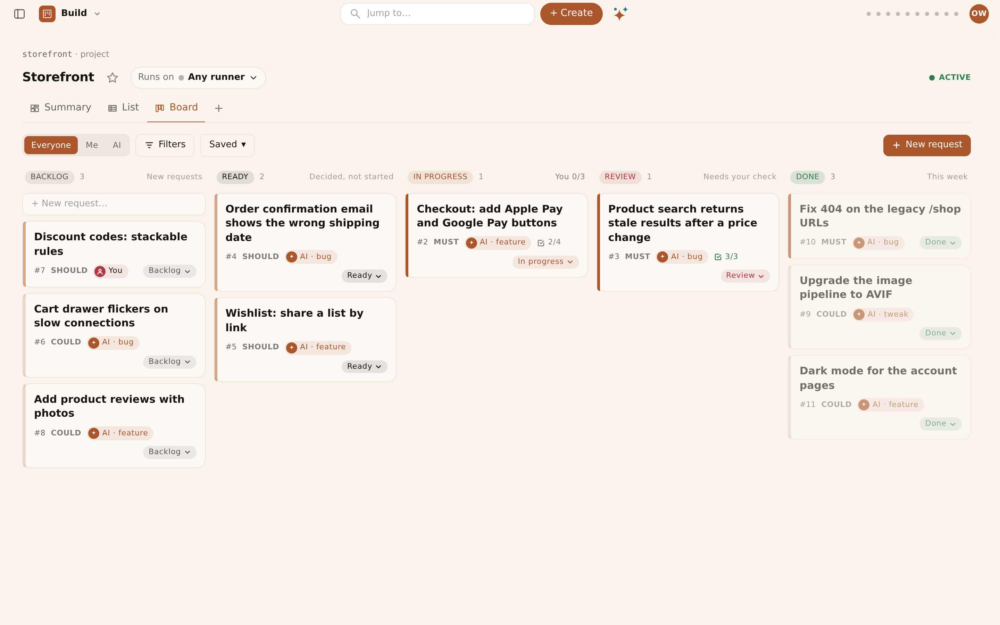
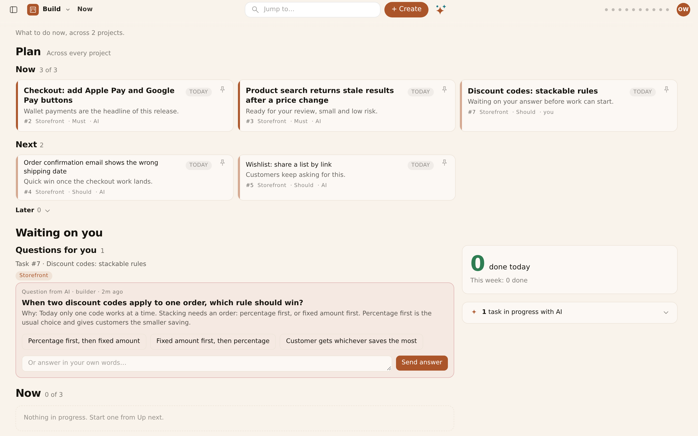
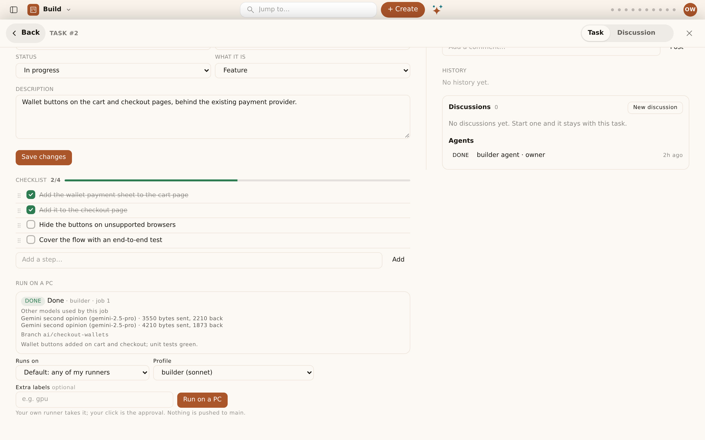
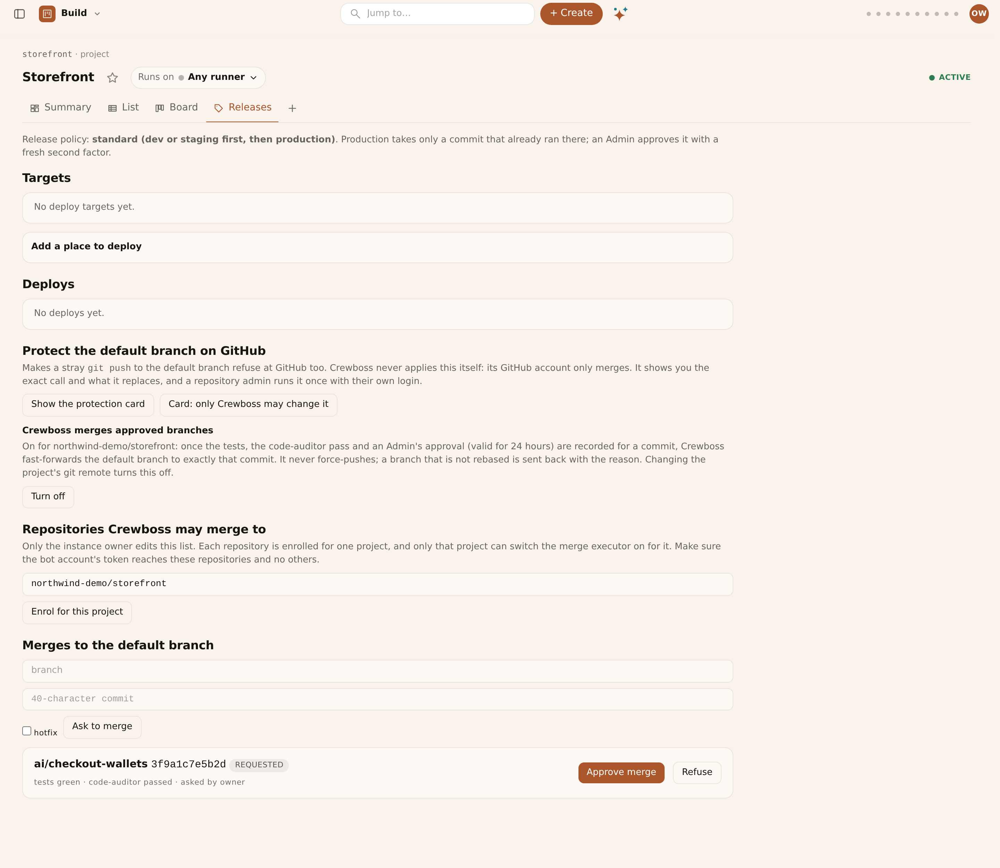
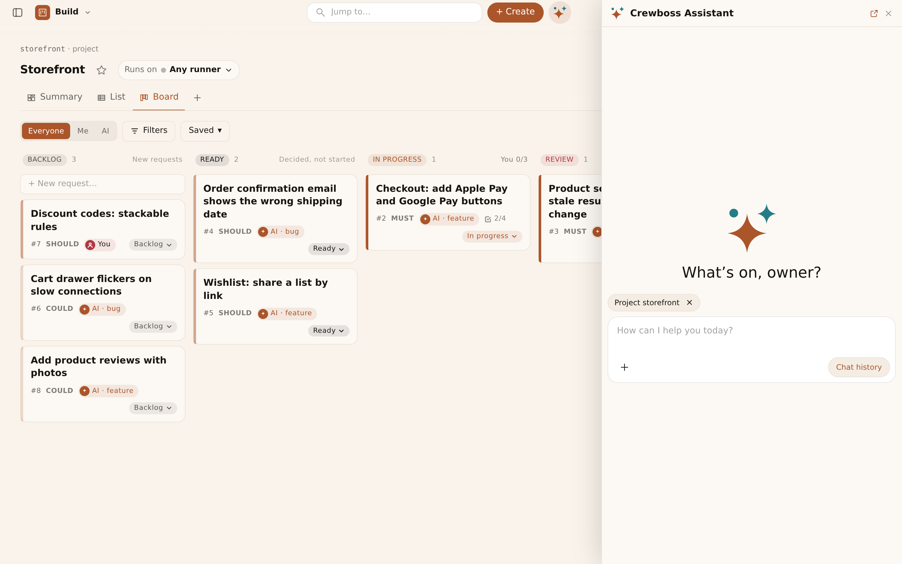

# Crewboss

Crewboss is a web page you run on your own computer. You write what you want done; an AI on one of your PCs does it and asks you before anything risky.

**Project management with Claude Code and Gemini built in.** Think Jira, except the AI runs the cycle. It triages new work, keeps the
plan across all your projects, builds each task on your own PCs, asks a second model to argue the design, and stops for your approval
before anything risky. Every task, plan, decision, question and note lives in one PostgreSQL database, not in memory files scattered
across repositories.

Built to be driven by conversation (no clicking required): talk to an AI about the work and let it manage the must-haves, should-haves and could-haves. Self-hosted,
Apache 2.0. The server runs no model: Claude Code and Gemini run on your machines, with your own sign-in or API key.



## Why Crewboss

If you build with Claude Code, your project's state ends up in `CLAUDE.md` files, memory notes, terminal scrollback and your head. The
priorities (what is a must-have, a should-have, a could-have) end up in a second program, a tracker the AI can't see and you keep in
step by hand. That works for one session on one repository. It breaks down with several sessions, several projects or several people.
Crewboss is both in one system: the AI's working memory and your backlog are the same PostgreSQL records.

It is also built to run without the board. You don't have to drive it through the board. Talk to an AI about the development cycle, in the
Crewboss Assistant or in any Claude Code session, and it files the work, sorts it into must, should and could, plans the order and hands
it to agents. The board is there when you want to look, and the decisions that are yours still come to you as questions.

* **One database instead of memory files.** Tasks, sub-tasks, plans, decisions, questions and knowledge are PostgreSQL rows with history.
  Every Claude Code session reads and writes the same records through Crewboss's MCP server (the standard way Claude Code talks to outside tools), so a new session picks up where the last one
  stopped, and nothing depends on a file someone forgot to update.
* **The AI runs the project-management cycle.** Sessions triage what comes in (a request, a bug, a failed health check), break it into
  sub-tasks, rank it into a plan across projects (Now, Next, Later), start jobs, review each other's work and re-plan when something
  changes. They ask you a question on the task when a decision is yours, and wait for the answer.
* **Claude builds, Gemini argues (optional).** For a plan, a design or a new product's shape, a job asks Google's Gemini for a second opinion and
  writes on the task what it took and what it rejected. Two models from different labs disagreeing in writing catch what one model
  agreeing with itself misses. Gemini can also draft logos and images for you to pick from. It's off by default and switched on per project,
  using your own Google API key on your own PC. See [docs/gemini.md](docs/gemini.md).
* **You approve. The AI doesn't merge or deploy on its own.** A merge needs passing tests, an independent AI code review of that exact
  commit and an Admin's approval with a fresh second factor. Production deploys are promote-only, with one-tap rollback.
* **Your machines, your keys.** Jobs run in throw-away copies of your project (git worktrees) on your own PCs (Linux, macOS, Windows, WSL2) and push a branch.
  Servers are reached with one-hour SSH passes. Keys for Claude and Gemini never reach Crewboss.

| | A tracker (Jira, Linear) | Claude Code with memory files | Crewboss |
|---|---|---|---|
| Where project state lives | a database | Markdown files per repository | PostgreSQL, shared by every session and person |
| Must, should and could | in the tracker | in a second program the AI can't see | the same records the AI reads and writes |
| How you drive it | clicking through boards | typing to one session at a time | talk to an AI; it runs the cycle |
| Who moves the work along | people | you | AI sessions triage, plan, build and review; you approve |
| Who writes the code | people | Claude Code | Claude Code on your PCs, one worktree per job |
| A second opinion | a colleague, if free | none | Gemini reviews plans and designs |
| Merge and deploy gates | other tools | none | tests, an AI code review and your approval |

## The cycle

```
 request, bug or failed health check
        │
        ▼
 triage ──▶ plan (Now / Next / Later, across projects) ──▶ job on your PC (Claude Code, own worktree)
                                                              │
                          Gemini second opinion on the design ◀┤
                                                              ▼
              tests + independent code review ──▶ your approval ──▶ merge ──▶ deploy ──▶ health checks
                                                                                            │
                                                         anything that fails becomes a task ◀┘
```

**The plan, kept by the AI across every project, and a question it is waiting on you to answer:**



**A task the AI built on a PC, with the Gemini second opinions it asked for along the way:**



**Nothing reaches the default branch until tests, an AI code review and your approval are recorded:**



## What's in it

* **Projects and tasks:** accounts that group projects; tasks with streams, priorities, due dates, sub-tasks, comments and
  milestones; Summary, List and Board views; a global plan the AI keeps and you can drag.
* **Questions and decisions:** an agent asks you on the task, with options; your answer and the decision are recorded where the next session
  will find them.
* **Knowledge:** notes and decisions that agents search and add to.
* **Crewboss Assistant (CA):** a chat drawer on every page. It answers questions about your open work, sets reminders and tells you when a job
  finishes. It acts on your behalf only after you tap a confirm card.
* **Runners:** `crewboss-runner` on your PC claims jobs and runs Claude Code with the tool list set by the job's profile. Each job gets its own
  narrow MCP that can only act on that one job. See [docs/runners.md](docs/runners.md).
* **Server access:** servers you add are reached with one-hour SSH passes signed by Crewboss's own certificate authority. Deploys and
  log reads use even narrower passes. See [docs/server-access.md](docs/server-access.md).
* **Deploys and release gates:** dev, staging and production targets, promote-only production, Admin approval with a fresh second factor,
  one-tap rollback and a merge executor. See [docs/multi-user.md](docs/multi-user.md).
* **Logic map:** each app you build keeps a map of its workflows and AI processes in its own repository (`.crewboss/logic/*.yaml`), checked
  by `crewboss logic check`. See [docs/logic-map.md](docs/logic-map.md).
* **Multi-user:** owner, designer and viewer roles; per-project Owner, Admin, Member and Viewer; password and authenticator-app sign-in (passkeys optional, once you have your own web address). A project someone may not see
  is a 404.



## Requirements

* The server computer: Linux, macOS, or Windows with WSL2, with `git`, Python 3.10 or newer (for the `./crewboss` launcher) and Docker Engine with
  Compose v2 ([install Docker](https://docs.docker.com/engine/install/); on Linux add yourself to the `docker` group with
  `sudo usermod -aG docker $USER`, then log out and in). The app image uses Python 3.12.
* For each runner PC: Python 3.12 or newer (Ubuntu 22.04 and Debian 12 need a newer one first; see [getting-started](docs/getting-started.md#requirements)),
  `git`, `pipx`, and Claude Code ([install](https://docs.claude.com/en/docs/claude-code), then type `claude` once and sign in; a Claude subscription,
  or an API key for an API runner). The runner works on Linux, macOS, Windows and WSL2.
* A GitHub repository for each project you want agents to work on.

## Quickstart

```
git clone https://github.com/crewboss-dev/crewboss.git
cd crewboss
./crewboss install            # asks: localhost or network? builds, starts, makes the owner, prints a one-time password
```

Then:

1. Open the printed URL at `/auth/login` (from another computer: `ssh -L <port>:localhost:<port> <server>` and open `http://localhost:<port>`, or install with `--mode network --domain <name>` for a permanent https address; see [docs/getting-started.md](docs/getting-started.md#opening-crewboss-from-another-computer)), sign in as `owner` with the temporary password, choose a password, scan the QR code with an authenticator app and save the recovery codes. On a home or office network, see [docs/lan-quickstart.md](docs/lan-quickstart.md) (about 5 minutes, nothing to install).
2. Make a project (open the menu, then the **+** next to **Accounts**) and set its GitHub remote (project **Settings** tab, "Edit repo and environments").
3. On a PC with Claude Code (Python 3.12 or newer; install pipx first, e.g. `sudo apt install pipx git` or `brew install pipx git`, on Windows `py -m pip install --user pipx`):
   ```
   pipx ensurepath          # then close this terminal and open a new one
   pipx install "git+https://github.com/crewboss-dev/crewboss.git#subdirectory=runner"      # Windows: py -m pipx install "git+...#subdirectory=runner"
   ```
   In Crewboss click the app name at the top left, choose **Administration**, then **Machines** (owner account only), stay on the **Runners** tab and press
   **New enrolment code**. Then on the PC run `crewboss-runner enrol '<code>'` and `crewboss-runner run` (it keeps that window busy; open a second
   one for `crewboss-runner status`). Chose "Just on this computer"? Add `--insecure-http` to `enrol`. Chose "home or office network" (recommended)?
   Do NOT add it: the code carries the server's certificate fingerprint and works as is. The in-app **How to set up a runner** card shows these steps per system.
4. Open a task and press **Run** (one button; Crewboss picks the runner). The outcome card says how it went, and the live runner view shows the agent at work. Limit which runners a project uses under **Runners for this project** (project Settings).

The full walk-through is in [docs/getting-started.md](docs/getting-started.md). Everything has a flag so it can run unattended, for
example `./crewboss install --mode network --domain crew.example.com --proxy bundled --yes`.

Other commands: `./crewboss up | down | restart | status`, `./crewboss logs [-f] [--tail N] [app|db|caddy]` (see `./crewboss logs --help`), `./crewboss owner [--reset]`, `./crewboss reset-owner`, `./crewboss lan-address` (LAN mode: the computer's network address changed), `./crewboss deploy-test` (a throwaway fresh install of the exact snapshot, see [docs/deploy-test.md](docs/deploy-test.md)) and `./crewboss logic check | uncovered | report | export` (the logic map, see [docs/logic-map.md](docs/logic-map.md)).

## Architecture in brief

```
 browser ──https──> reverse proxy (yours, or bundled Caddy) ──> app (FastAPI + MCP) ──> Postgres
                                                                  ^
 your PC: crewboss-runner ──outbound connection (/runner/ws)───────┘
            └─ Claude Code in a temporary copy of the project per job ──> pushes the branch to GitHub
 app ──one-hour SSH pass──> your servers (deploys, reads)
```

* `app/`: the web app, REST API and MCP server (FastAPI, Jinja and htmx pages).
* `db/`: Postgres migrations. The app owns its database.
* `runner/`: the `crewboss-runner` package.
* `scanner/`: workflow and AI discovery for the logic map and catalog.
* `scripts/`, `sessions/`, `tools/`: helper scripts and optional extras.
* `docs/`: guides and protocol documents.

The server runs no model. All Claude work happens on runners, with the sign-in or API key already on that PC. The key never reaches Crewboss.

## Documentation

| Guide | What it covers |
|---|---|
| [docs/getting-started.md](docs/getting-started.md) | install, first sign-in, first project, first job |
| [docs/configuration.md](docs/configuration.md) | the instance folder and every `instance.yaml` key |
| [docs/runners.md](docs/runners.md) | installing runners on Linux, macOS, Windows and WSL2 |
| [docs/server-access.md](docs/server-access.md) | servers, SSH passes, deploy targets, server reads |
| [docs/threat-model.md](docs/threat-model.md) | what Crewboss protects, what it does not, who you trust, a safe-deployment checklist |
| [docs/multi-user.md](docs/multi-user.md) | roles, release governance, merge executor |
| [docs/runner-protocol.md](docs/runner-protocol.md) | the runner WebSocket protocol and how agents are launched |
| [docs/deploy-executor.md](docs/deploy-executor.md) | deploy requests, approvals and the executor |
| [docs/server-reads.md](docs/server-reads.md) | reading logs and probes on a server |
| [docs/logic-map.md](docs/logic-map.md) | the logic map file format and checks |
| [docs/deploy-test.md](docs/deploy-test.md) | a throwaway fresh install of a release, checked and deleted |
| [docs/reference.md](docs/reference.md) | detailed implementation notes (the older README) |

Contributing: [CONTRIBUTING.md](CONTRIBUTING.md). Security: [SECURITY.md](SECURITY.md) and the [threat model](docs/threat-model.md). Conduct: [CODE_OF_CONDUCT.md](CODE_OF_CONDUCT.md).

## Licence

Apache License 2.0. See [LICENSE](LICENSE) and [NOTICE](NOTICE). Contributions are accepted under the Developer Certificate of
Origin: sign your commits with `git commit -s`.
